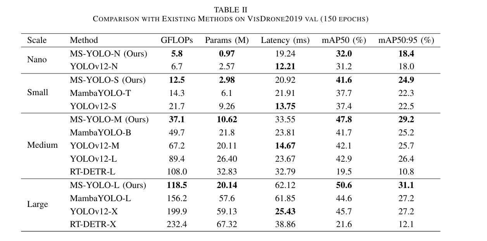

# MS-YOLO: A Mamba-Swin Transformer Hybrid Architecture for Efficient Small Object Detection

  [](README.md)

### Inference on VisDrone 2019 dataset



## Getting started

### 1. Installation

MS-YOLO is developed based on `torch==2.3.0` `pytorch-cuda==12.1` and `CUDA Version==12.8`. 

#### 2.Clone Project 

```bash
git clone https://github.com/zhongwr2/ms-yolo.git
```

#### 3.Create and activate a conda environment.
```bash
conda create -n msyolo -y python=3.11
conda activate msyolo
```

#### 4. Install torch

```bash
pip install torch===2.3.0 torchvision torchaudio
```

#### 5. Install Dependencies
```bash
pip install timm einops
cd selective_scan && pip install . --no-build-isolation
cd .. && pip install -v -e .
```

#### 6. Prepare VisDrone2019 Dataset
Make sure your dataset structure as follows:
```
├── VisDrone
│   ├── annotations
│   │   ├── instances_train2017.json
│   │   └── instances_val2017.json
│   ├── images
│   │   ├── train2017
│   │   └── val2017
│   ├── labels
│   │   ├── train2017
│   │   ├── val2017
```
The official VisDrone.yaml configuration file includes an automatic data processing script (visdrone2yolo function). If you haven't downloaded the VisDrone dataset yet, simply specify the storage path in the yaml file and it will be automatically downloaded and converted to the above format during runtime.

```bash
vi ultralytics/cfg/datasets/VisDrone.yaml
```

#### 7. Training MS-YOLO
```bash
python mamba_swin_train.py
```

## Acknowledgement

This repo is modified from open source real-time object detection codebase [Ultralytics](https://github.com/ultralytics/ultralytics). The selective-scan from [VMamba](https://github.com/MzeroMiko/VMamba).

